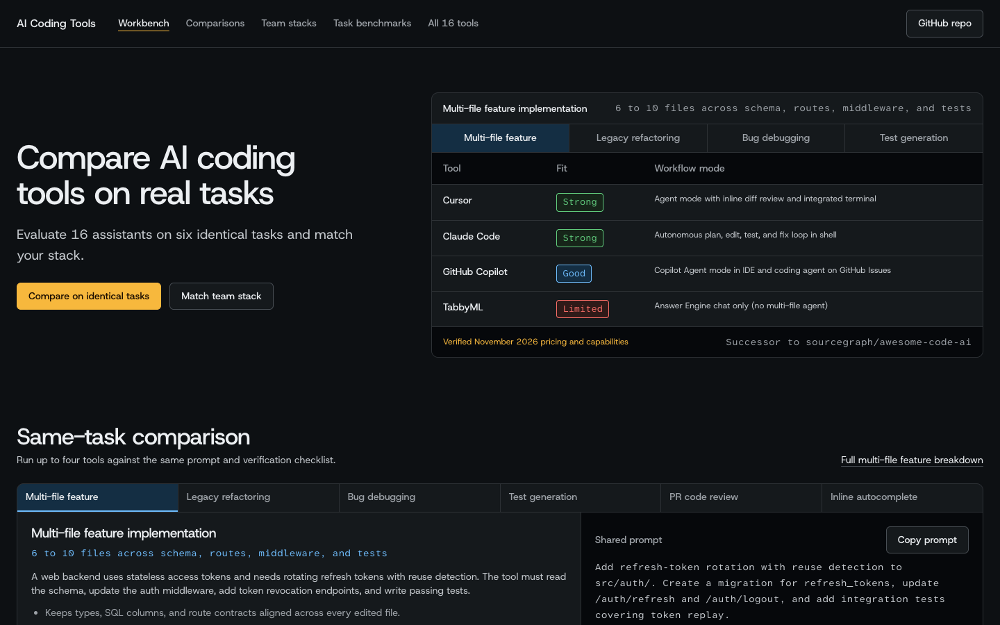

# AI Coding Tools Comparison and Team Stack Selector

[](https://developer-assistants.github.io/ai-coding-tools/)
[](./LICENSE)
[](https://developer-assistants.github.io/ai-coding-tools/tools/)
[](https://developer-assistants.github.io/ai-coding-tools/tasks/)

**AI Coding Tools** is an open-source comparison workbench and **team stack selector** that evaluates 16 **AI coding assistants**, **agentic IDEs**, **terminal coding agents**, and **self-hosted Copilot alternatives** on 6 identical software engineering tasks.

Built as a practical successor to the archived [`sourcegraph/awesome-code-ai`](https://github.com/sourcegraph/awesome-code-ai) directory, this repository pairs qualitative same-task evaluations with an interactive decision matrix you can filter by editor, language stack, privacy rules, and budget. Pricing and product tiers are verified as of November 2026.

Live interactive workbench: [https://developer-assistants.github.io/ai-coding-tools/](https://developer-assistants.github.io/ai-coding-tools/)



## Same-task comparison across 16 AI coding tools

Every tool is evaluated qualitatively (`Strong`, `Good`, `Partial`, `Limited`) against the same 6 tasks based on native workflow support, context handling, and verification loops:

1. Multi-file feature implementation: JWT refresh-token rotation across middleware, SQL migration, routes, and integration tests.
2. Legacy codebase refactoring: converting a 4,000-line CommonJS Express service to strict TypeScript ESM.
3. Production bug debugging: tracing an intermittent Redis cache invalidation race condition with a failing reproduction test.
4. Automated test generation: adding branch coverage for billing proration and retried webhook handlers.
5. Pull request code review: auditing a 600-line diff for SQL injection, N+1 queries, and missing role checks.
6. Fast inline autocomplete: low-latency ghost-text and next-edit completions while writing typed endpoints.

| Tool | Category | Editors | Multi-file feature | Legacy refactor | Bug debugging | Test gen | PR review | Inline Tab | Pricing (Nov 2026) |
| :--- | :--- | :--- | :---: | :---: | :---: | :---: | :---: | :---: | :--- |
| [Cursor](https://cursor.com) | Agentic IDE | VS Code fork | Strong | Strong | Strong | Strong | Good | Strong | Free $0; Plus $8/mo; Premium $30/mo; Teams $30-$200/seat/mo |
| [Claude Code](https://www.anthropic.com/claude-code) | Terminal Agent | CLI, VS Code, JetBrains, Neovim | Strong | Strong | Strong | Strong | Strong | Limited | Claude Pro $20/mo or Max $100+/mo; API, Bedrock, Vertex |
| [GitHub Copilot](https://github.com/features/copilot) | IDE Extension | VS Code, JetBrains, Neovim, CLI | Good | Good | Good | Strong | Strong | Strong | Free $0; Pro $10/mo; Business $19/user/mo; Enterprise $39/user/mo |
| [Windsurf](https://windsurf.com) | Agentic IDE | VS Code fork, JetBrains | Strong | Good | Good | Strong | Good | Strong | Free $0; Pro $20/mo; Teams ~$40/seat/mo; Max $200/mo |
| [OpenAI Codex CLI](https://github.com/openai/codex) | Terminal Agent | CLI, VS Code, Neovim | Strong | Strong | Strong | Strong | Strong | Limited | Apache-2.0 CLI; ChatGPT Plus ($20/mo) / Pro or OpenAI API |
| [Aider](https://aider.chat) | Terminal Agent | CLI, any editor | Strong | Strong | Good | Strong | Good | Limited | Free Apache-2.0 client; BYOK or local Ollama/vLLM |
| [Cline](https://cline.bot) | IDE Extension | VS Code, JetBrains | Strong | Strong | Strong | Strong | Good | Limited | Free Apache-2.0 extension; BYOK |
| [Continue](https://continue.dev) | Self-Hosted / BYOK | VS Code, JetBrains | Good | Good | Good | Good | Good | Strong | Free Apache-2.0 extension; BYOK or local Ollama/vLLM |
| [Kiro](https://kiro.dev) | Agentic IDE | VS Code fork, CLI | Strong | Good | Good | Strong | Good | Good | Free $0; Pro ~$20/mo; Team $20+/seat/mo; Power up to $200/mo |
| [Augment Code](https://www.augmentcode.com) | IDE Extension | VS Code, JetBrains, Neovim | Strong | Strong | Strong | Strong | Good | Strong | Standard $20/mo or Business $100/mo (pooled up to 50 seats + usage) |
| [Sourcegraph Cody](https://sourcegraph.com/cody) | IDE Extension | VS Code, JetBrains, Neovim | Good | Strong | Good | Good | Good | Good | Enterprise-only bundled with Sourcegraph (from $16,000/yr min) |
| [Amazon Q Developer](https://aws.amazon.com/q/developer/) | IDE Extension | VS Code, JetBrains, CLI | Good | Strong | Good | Good | Strong | Good | Free $0; Pro $19/user/mo (IDE plugins end support Apr 30, 2027) |
| [Google Gemini Code Assist](https://codeassist.google) | IDE Extension | VS Code, JetBrains, CLI | Good | Good | Good | Good | Strong | Good | Cloud / Workspace Standard ~$19/user/mo; Enterprise ~$45/user/mo |
| [JetBrains AI Assistant](https://www.jetbrains.com/ai/) | IDE Extension | JetBrains IDEs | Good | Strong | Good | Strong | Good | Strong | AI Free $0 (paid IDE); AI Pro $20/mo; AI Ultimate $60/mo |
| [Tabnine](https://www.tabnine.com) | Enterprise Private | VS Code, JetBrains, Neovim | Partial | Good | Good | Good | Good | Strong | Code Assistant $39/user/mo; Agentic Platform $59/user/mo (annual) |
| [TabbyML](https://tabby.tabbyml.com) | Self-Hosted OSS | VS Code, JetBrains, Neovim | Limited | Partial | Partial | Partial | Limited | Strong | Free self-hosted Apache-2.0 server; paid Enterprise |

## Team stack selection table

Use this matrix as a starting point, or open the [interactive stack selector](https://developer-assistants.github.io/ai-coding-tools/#team-stack-selector) to apply hard filters (self-hosted only, open source only, MCP support, inline autocomplete) and export a Markdown RFC table.

| Team stack | Typical editor and privacy | Primary recommendation | Secondary or companion pick | Why this pairing works |
| :--- | :--- | :--- | :--- | :--- |
| [TypeScript / React / Next.js](https://developer-assistants.github.io/ai-coding-tools/stacks/typescript-react/) | VS Code, Cloud SaaS | Cursor | Claude Code or Windsurf | Fast multi-line Tab predictions plus tight TypeScript compiler feedback loops. |
| [Python / FastAPI / ML](https://developer-assistants.github.io/ai-coding-tools/stacks/python-ml/) | VS Code or PyCharm, Cloud / BYOK | Claude Code | Cursor, Aider, or OpenAI Codex CLI | Pytest, ruff, and mypy give shell agents fast verification. |
| [Java / Kotlin / Spring Boot](https://developer-assistants.github.io/ai-coding-tools/stacks/java-kotlin-jetbrains/) | IntelliJ IDEA, Enterprise ZDR | JetBrains AI Assistant | GitHub Copilot or Amazon Q Developer | Keeps native IntelliJ PSI refactorings intact; Amazon Q adds automated JDK upgrades. |
| [Go / Rust / Systems](https://developer-assistants.github.io/ai-coding-tools/stacks/go-rust-systems/) | Terminal / Neovim / VS Code | Claude Code or OpenAI Codex CLI | Aider or GitHub Copilot | Strict compilers (`cargo check`, `go test -race`) make CLI agents reliable on complex fixes. |
| [Self-hosted / Air-gapped](https://developer-assistants.github.io/ai-coding-tools/stacks/self-hosted-airgapped/) | VS Code or JetBrains, On-prem GPU | TabbyML or Continue | Tabnine Enterprise or Aider (local vLLM) | Separates fast local FIM autocomplete from private VPC chat or multi-file agents. |
| [Enterprise Monorepo](https://developer-assistants.github.io/ai-coding-tools/stacks/enterprise-monorepo/) | Mixed IDEs, ZDR / SOC 2 | GitHub Copilot Enterprise | Augment Code or Sourcegraph Cody | Broad IDE coverage, native PR review, and deep indexing across large repositories. |

## Head-to-head comparison guides

- [Cursor vs GitHub Copilot](https://developer-assistants.github.io/ai-coding-tools/compare/cursor-vs-github-copilot/)
- [Claude Code vs Cursor](https://developer-assistants.github.io/ai-coding-tools/compare/claude-code-vs-cursor/)
- [Windsurf vs Cursor](https://developer-assistants.github.io/ai-coding-tools/compare/windsurf-vs-cursor/)
- [Aider vs Claude Code](https://developer-assistants.github.io/ai-coding-tools/compare/aider-vs-claude-code/)
- [Cline vs Continue](https://developer-assistants.github.io/ai-coding-tools/compare/cline-vs-continue/)
- [OpenAI Codex CLI vs Claude Code](https://developer-assistants.github.io/ai-coding-tools/compare/codex-cli-vs-claude-code/)
- [TabbyML vs GitHub Copilot](https://developer-assistants.github.io/ai-coding-tools/compare/tabby-vs-github-copilot/)
- [Amazon Q Developer vs GitHub Copilot](https://developer-assistants.github.io/ai-coding-tools/compare/amazon-q-vs-github-copilot/)

## Local development and testing

```bash
git clone https://github.com/developer-assistants/ai-coding-tools.git
cd ai-coding-tools
npm install
npm run dev
```

Run unit tests covering dataset integrity, hard hosting/license constraints, and Markdown RFC table export:

```bash
npm test
```

Build the production bundle and generate all 25 static SEO pages, `sitemap.xml`, `robots.txt`, and `llms.txt`:

```bash
npm run build
```

## Architecture

- [`src/data/tools.ts`](./src/data/tools.ts): Structured data for 16 AI coding tools across all 6 standardized tasks with November 2026 pricing.
- [`src/data/tasks.ts`](./src/data/tasks.ts): Identical engineering task scenarios, criteria, and shared prompt blueprints.
- [`src/data/stacks.ts`](./src/data/stacks.ts): Six team stack profiles with rollout notes and pitfalls.
- [`src/data/comparisons.ts`](./src/data/comparisons.ts): Eight head-to-head comparison guides with FAQs.
- [`src/engine/selector.ts`](./src/engine/selector.ts): Deterministic criteria-matching engine and Markdown/JSON RFC exporter.
- [`scripts/generate-seo-pages.mjs`](./scripts/generate-seo-pages.mjs): Pre-renders 25 static HTML routes, Schema.org JSON-LD, `sitemap.xml`, `robots.txt`, and `llms.txt`.

## Frequently asked questions

### Which AI coding tool is best for multi-file features and refactoring?
Claude Code, Cursor, OpenAI Codex CLI, Cline, and Windsurf handle multi-file features well because they search the repository, coordinate diffs across files, and run compiler or test loops automatically.

### What is the best open-source self-hosted alternative to GitHub Copilot?
TabbyML and Continue are the leading open-source choices. TabbyML runs as a single Rust server for private inline completions and repo Q&A, while Continue connects VS Code and JetBrains to Ollama, vLLM, or private enterprise model gateways.

### Should a team use a terminal coding agent or an agentic IDE?
Agentic IDEs like Cursor and Windsurf combine low-latency inline Tab autocomplete with visual diff editing in one window. Terminal agents like Claude Code, OpenAI Codex CLI, and Aider work across any editor and fit deep refactors and headless CI checks. Many teams pair a lightweight inline extension with a terminal agent.

## Support the project

If this comparison workbench or stack selector helped your team pick an AI coding tool, consider giving the repository a **Star** so other engineering leads can find it.

## License

Distributed under the [MIT License](./LICENSE).
